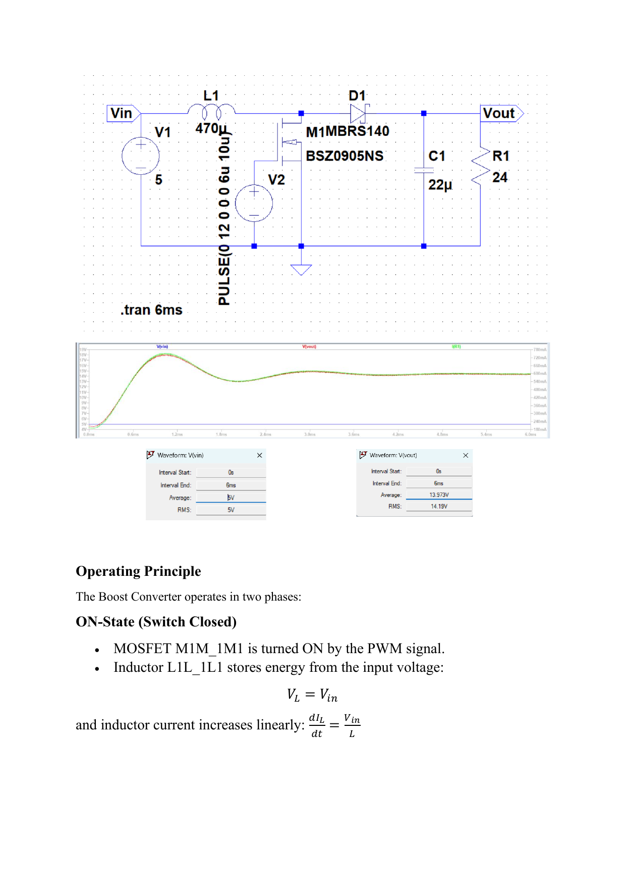
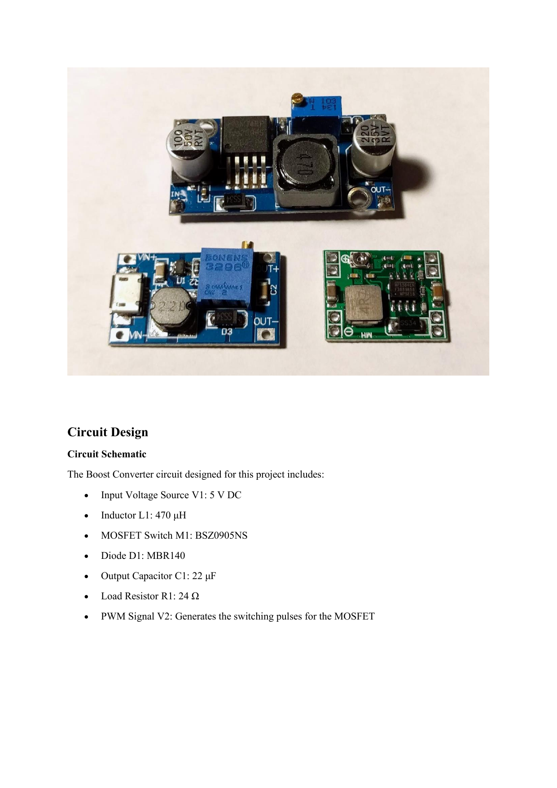

# DC-DC Boost Converter Design

[](https://www.analog.com/en/resources/design-tools-and-calculators/ltspice-simulator.html)
[](#design-summary)

> A DC-DC boost converter designed and simulated in LTspice to step a 5 V input up to approximately 14 V.



## Overview

This academic power-electronics project demonstrates the design, operation, and transient simulation of a non-isolated boost converter. A PWM-driven MOSFET stores energy in the inductor during the ON state and transfers it through a Schottky diode to the output during the OFF state.

**Portfolio highlights**

- Designed a 5 V to approximately 14 V DC-DC boost-converter simulation.
- Applied PWM switching at 100 kHz with an approximately 60% duty cycle.
- Used LTspice to evaluate start-up and steady-state behaviour over a 6 ms transient analysis.
- Documented component selection, operating states, and output-voltage results.

## Design summary

| Parameter | Value |
| --- | ---: |
| Input voltage | 5 V DC |
| Simulated output voltage | 13.973 V average |
| PWM drive | 0-12 V, 100 kHz |
| Duty cycle | 60% |
| Inductor | 470 uH |
| Switching MOSFET | BSZ0905NS |
| Diode | MBRS140 Schottky diode |
| Output capacitor | 22 uF |
| Load | 24 ohm |
| Simulation | 6 ms transient analysis |

## Operating principle

1. **Switch ON:** the MOSFET connects the inductor to ground, allowing its current to ramp up and store energy.
2. **Switch OFF:** the inductor voltage reverses, the diode conducts, and stored energy is delivered to the output capacitor and load.

For an ideal boost converter:

```text
Vout = Vin / (1 - D)
```

The simulated design verifies the expected step-up behaviour, with the output settling near 14 V from a 5 V supply.

## Project evidence

| Hardware references | Simulation evidence |
| --- | --- |
|  |  |
| Commercial boost-module references examined during the project. | LTspice schematic, start-up waveform, and measured output. |

## Repository layout

```text
.
├── simulation/
│   └── boost-converter.asc          # LTspice schematic
├── docs/
│   ├── assets/                      # Project images
│   └── report/                      # Original project report
└── README.md
```

## Run the simulation

1. Install [LTspice](https://www.analog.com/en/resources/design-tools-and-calculators/ltspice-simulator.html).
2. Open `simulation/boost-converter.asc`.
3. Run the included `.tran 6ms` command.
4. Plot `V(Vin)` and `V(Vout)` to inspect the boost-converter response.

## Project context

| Field | Details |
| --- | --- |
| Course | Power Electronics Laboratory |
| Institution | Islamic University of Gaza |
| Author | Yahya Al Afifi |
| Focus | DC-DC conversion, PWM switching, LTspice simulation |

## Notes

This repository is a portfolio archive of an academic simulation project. Results are simulation-based; any hardware implementation should include appropriate component ratings, layout considerations, thermal design, and safety review.

